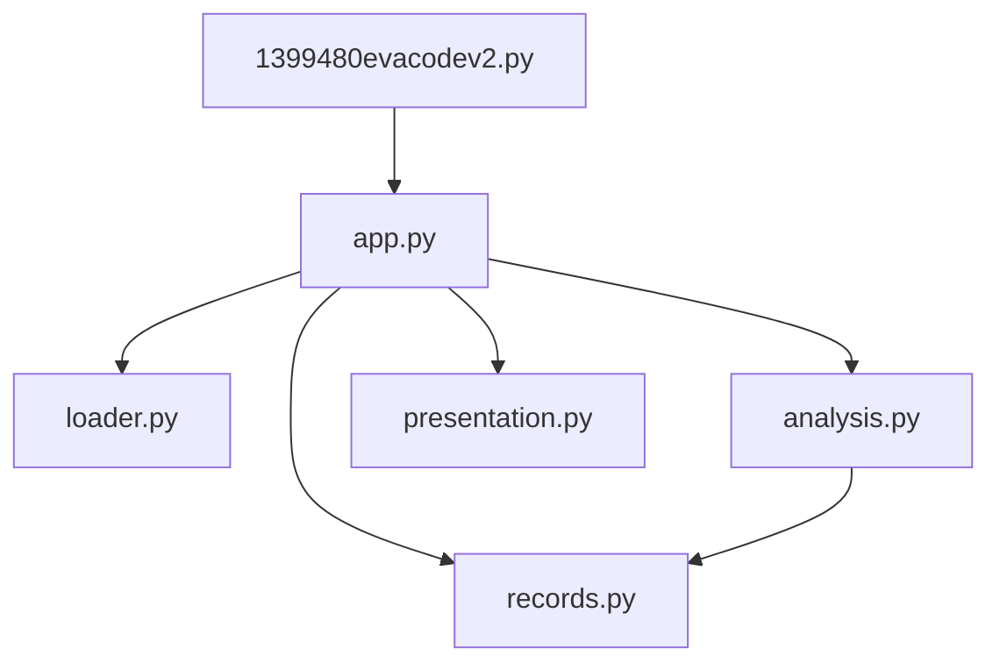

# Proposed Architecture

## Modules and their responsibilities

I'm splitting the script into five small modules inside a folder called eva, each with one job:

- loader.py reads the data file.
- records.py checks each entry, skips the bad ones and turns the good ones into a simple record with a date, hours and country.
- analysis.py does all the calculations. It never reads files, prints anything or asks for input.
- presentation.py handles everything the user sees: printing, asking questions and saving the chart.
- app.py runs the steps in order and passes data between the others.

The original script (1399480evacodev2.py) stays as the starting point, so you still run the program the same way. It now just hands over to app.py.

## Dependencies between modules

app.py uses the other four, because it's the one running things. analysis.py uses records.py, because it works with the records that module produces. Nothing else depends on anything. Everything points one way, so changing how results look can't break a calculation.

## Interfaces between modules

The modules only pass data to each other through function inputs and return values, never through shared variables. The main functions are:

```
load_eva_data(path)                -> the raw data
prepare_records(raw)               -> clean records, number skipped
categorise_eva_by_length(records)  -> short, standard and long counts
cumulative_duration(records)       -> dates and running totals
country_summary(records, country)  -> count, total and average
```

The functions in presentation.py take these results and display them. If a country has no EVAs, its average is left empty (None), which the comparison feature needs later on.

## Architecture diagram

Each arrow points to a module the one above it uses.



## AR1: Separation of concerns

Each of the five jobs in the brief gets its own module: reading data (loader.py), checking and preparing it (records.py), calculations (analysis.py), showing results (presentation.py) and running everything (app.py). In the original they're all in one file, and some of them share the same loop.

## AR2: Why these module boundaries

I drew the lines based on what would make each part change. A new data source only affects loader.py. A new rule for what counts as a valid record only affects records.py. A new calculation only touches analysis.py, a change to how things look only touches presentation.py, and adding a step only touches app.py. So each module has one reason to change.

For example, turning "6:15" into hours goes in records.py rather than analysis.py, because it's tidying up the data, not analysing it.

## AR3: Coupling in the inherited code and how it is addressed

The clearest example is the country totals. The original drops the country from each cleaned record, so the totals have to be added up inside the loop that reads the data and kept in two global dictionaries. The country report only works if that loop has already run, and any new country-based calculation would mean going back into the loop.

In the new version each record keeps its country, and the country summary is worked out from the records whenever it's needed. Reading the data and calculating country stats aren't tangled together anymore.

Two smaller fixes follow the same idea. The file name is now passed in by app.py instead of being hard-coded where the file is opened. And the calculations return their results instead of printing them, so they don't care how results are shown.

## AR4: Why the functions in each module belong together

- loader.py has just one function, for reading the file.
- records.py has everything to do with turning raw entries into clean records. These all change together if the data format changes.
- analysis.py has everything that calculates something from the clean records.
- presentation.py has everything the user sees or types. It's the only part that knows about the screen or matplotlib.
- app.py has only the main function, which decides the order things happen in.
