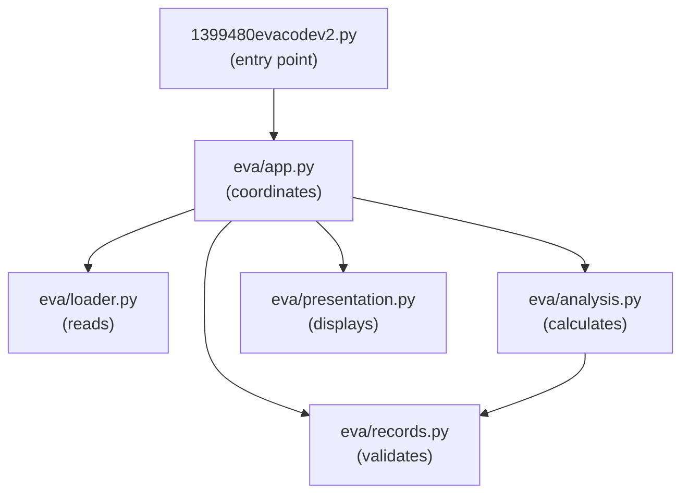

# Proposed Architecture

## Modules and their responsibilities

I'll split the script into five modules in a new `eva` package, and keep the existing script as the entry point:

- `eva/loader.py` (reading data): opens the JSON file and returns the raw list of records. It's the only module that reads files.
- `eva/records.py` (validating and preparing data): defines `EvaRecord` (date, duration in hours, country), `parse_duration_hours`, and `prepare_records`, which skips invalid records, counts them and returns the valid ones sorted by date.
- `eva/analysis.py` (calculations): `categorise_eva_by_length`, `cumulative_duration` and `country_summary`. They take a list of `EvaRecord` and return results. They never read files, print or ask for input.
- `eva/presentation.py` (presenting results): prints the category breakdown, the skipped-row count and the country summary, asks for the country, and saves the chart. It's the only module that uses print, input or matplotlib.
- `eva/app.py` (coordinating execution): `main()` runs the steps in order and passes data between the modules. It also holds the data file path.
- `1399480evacodev2.py` (entry point): keeps its name, so the app still runs with `python 1399480evacodev2.py`. It now only calls `main()`.

## Dependencies between modules

- app depends on loader, records, analysis and presentation, because it coordinates them.
- analysis depends on records, because it works on `EvaRecord` objects.
- loader, records and presentation don't import any other module from the project.
- The entry script depends only on app.

Dependencies only point one way, and nothing depends on app or presentation. So changing how results are shown can't break a calculation.

## Interfaces between modules

Modules only talk to each other through function arguments and return values, not shared variables:

```
loader.load_eva_data(path) -> list of dicts
records.parse_duration_hours(text) -> float or None
records.prepare_records(raw) -> (list of EvaRecord, skipped count)
analysis.categorise_eva_by_length(records) -> {category: {count, percentage}}
analysis.cumulative_duration(records) -> (dates, cumulative hours)
analysis.country_summary(records, country) -> CountrySummary
presentation.save_cumulative_chart(dates, hours, path)
presentation.show_category_breakdown(categories)
presentation.show_skipped(count)
presentation.ask_country() -> str
presentation.show_country_summary(country, summary)
app.main()
```

`EvaRecord` and `CountrySummary` (count, total_hours, average_hours) are small dataclasses, so each value has a name instead of a position in a tuple. `average_hours` is None when a country has no EVAs, which the new comparison feature also needs.

## Architecture diagram

Each arrow points from a module to a module it depends on.



## AR1: Separation of concerns

Each of the five responsibilities in the brief gets its own module:

- Reading data: `loader.py`
- Validating and preparing data: `records.py`
- Performing calculations and analysis: `analysis.py`
- Presenting results: `presentation.py`
- Coordinating application execution: `app.py`

In the inherited script all five are in one file, and several of them are in the same loop.

## AR2: Why these module boundaries

I chose the boundaries by asking what would make each part of the code change:

- A different data source or file format only changes `loader.py`.
- New validation rules (for example rejecting 0:00 durations) only change `records.py`.
- New or changed calculations only change `analysis.py`.
- Changing how results look (wording, decimal places, chart labels, or a GUI instead of the console) only changes `presentation.py`.
- Changing the order of the steps, or adding a step, only changes `app.py`.

These are the same responsibilities I found in the assessment, so each module has one reason to change. For example, `parse_duration_hours` goes in `records.py` rather than `analysis.py`, because turning text into hours is preparing data, not analysing it.

## AR3: Coupling in the inherited code and how it is addressed

The clearest example of coupling in the inherited code is between parsing and the country statistics. The records list only keeps (date, duration) and drops the country, so the per-country totals and counts have to be added up inside the parsing loop (lines 90 to 97) and kept in two global dictionaries. The country report then depends on the loop having filled them in. Any new country-based calculation would mean editing the parsing loop again.

In the new structure `EvaRecord` keeps the country, and `country_summary` works out the count, total and average from the list of records when it's called. Parsing no longer does any country calculations, and the analysis doesn't depend on the order the top-level code runs in.

Two other examples are fixed the same way:

- The data filename is hard-coded where the file is read. Now `app.py` passes the path to `load_eva_data`, so a change to how data is loaded only affects `loader.py`.
- Results are printed in the middle of the calculations. Now the analysis functions return values and only `presentation.py` prints them, so analysis doesn't depend on how results are displayed.

## AR4: Why the functions in each module belong together

- `loader.py`: one function, `load_eva_data`. Everything about reading the file is in one place.
- `records.py`: `EvaRecord`, `parse_duration_hours` and `prepare_records` all turn raw JSON entries into clean, valid records. They change together when the data format or validation rules change.
- `analysis.py`: `categorise_eva_by_length`, `cumulative_duration` and `country_summary` all take cleaned records and calculate something from them, with no input or output.
- `presentation.py`: every function either shows a result to the user or asks the user for something. It's the only module that knows about the console and matplotlib.
- `app.py`: only `main()`, which decides the order of the steps.
